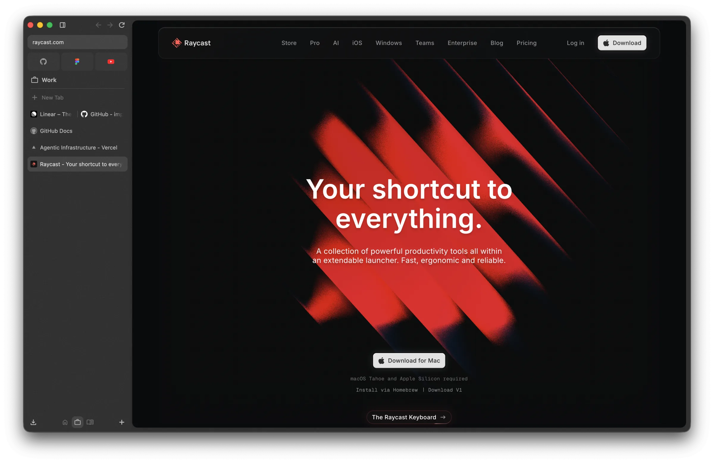
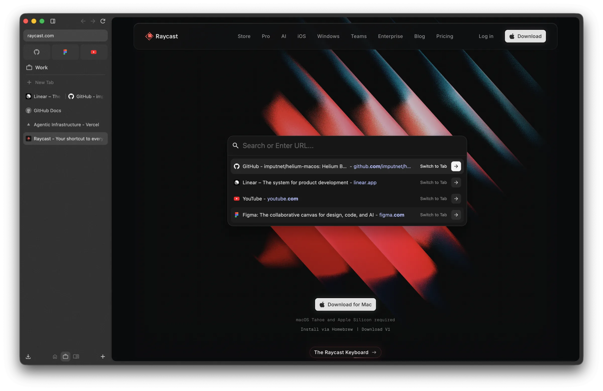
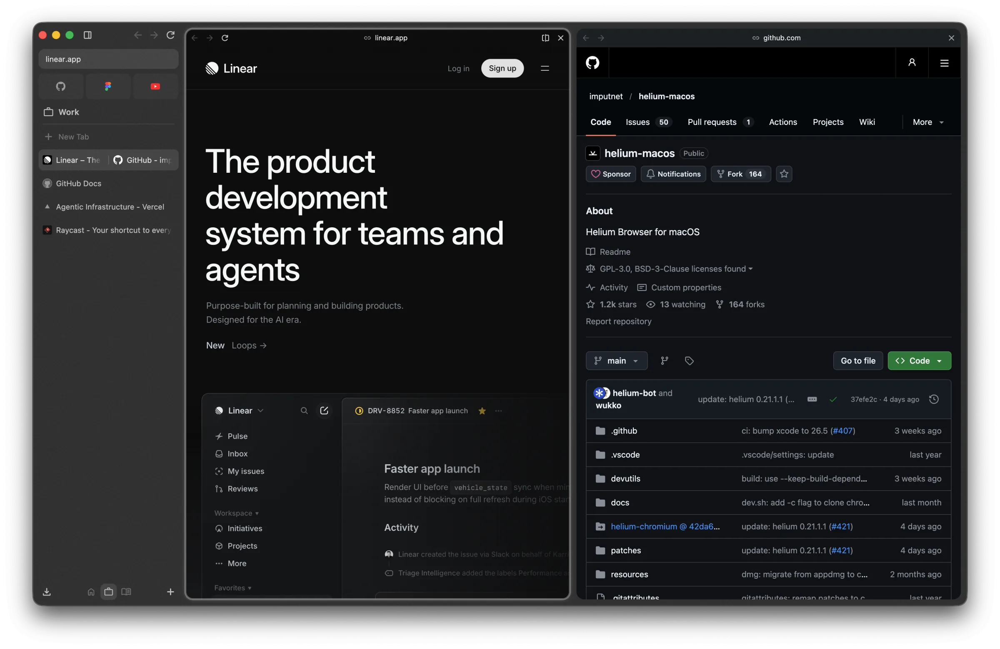

# Arcelium

[Helium](https://github.com/imputnet/helium) for macOS, reworked to feel like Arc.



Arc is winding down, and none of the browsers I tried as a replacement felt
right, so I vibe-coded Helium into what I wanted.

## Features

- **Layout:** no top toolbar. The address bar, navigation and extensions live in the sidebar. The page has a rounded frame over a translucent window, and full screen keeps the sidebar.
- **Command bar:** ⌘T and ⌘L open a floating command bar over the page instead of a new tab page. It lists recent open tabs first.
- **Spaces:** each space has its own tabs, pinned tiles, icon and gradient theme. Swipe to switch between them. A space can also keep separate logins and cookies.
- **Tabs:** new tab pages don't clutter the sidebar. Drag a tab onto the page to split the view.
- **Little windows:** links from other apps open in a small window, and ⌘O moves the page into the main window.

<p>
  
  
</p>

## Build

```sh
scripts/build.sh
```

This clones [helium-macos](https://github.com/imputnet/helium-macos) at the
version in `scripts/helium-version.sh` and applies `patches/` on top. It then
runs the helium-macos build, so you need helium-macos's build requirements.

Then go to Settings → Appearance → Layout, pick Vertical and turn on "Address
bar in sidebar".

It installs as its own app (`io.github.andrew-sem.arcelium`) and keeps its own
profile, so it can live next to a regular Helium.

## License

GPL-3.0
